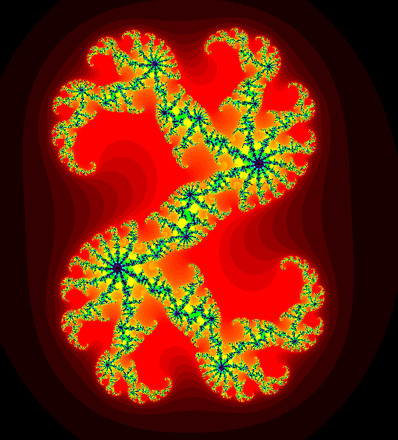
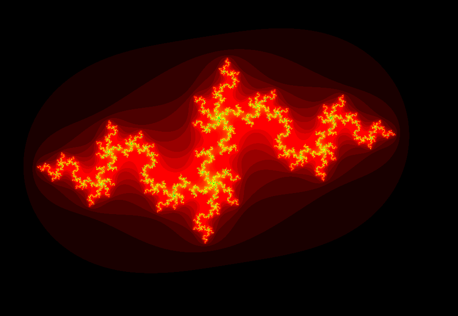
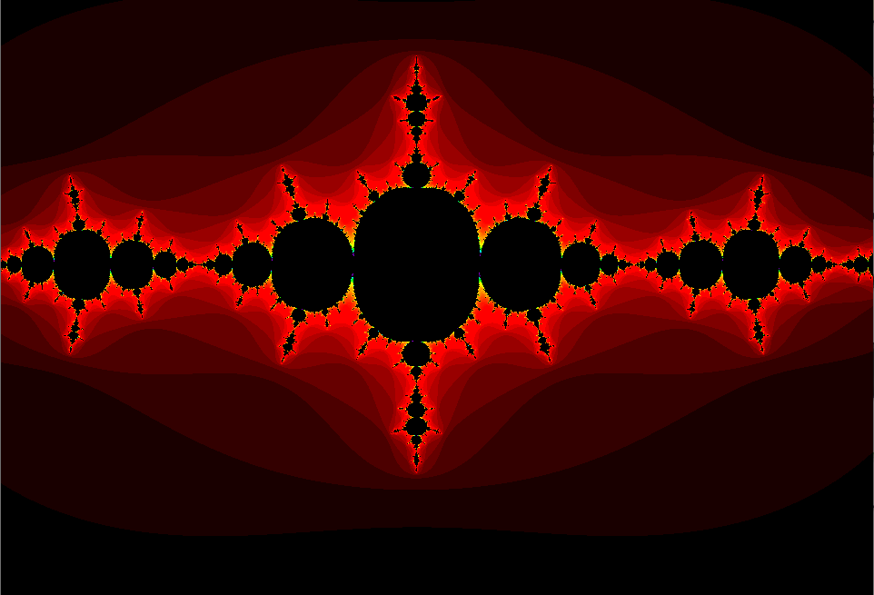

# Julia Set

This program visualizes fractals, displaying colorful patterns that change dynamically.

## Controls

- Move the mouse to change the shape of the fractal.
- Click to start or stop using the mouse position.
- Scroll to zoom in or out around the mouse position.
- Use the arrow keys to move around the image.

## Screenshots

## Video

[Watch the Julia set demo](juliaset%202024-04-04%2014-25-36.mp4)
