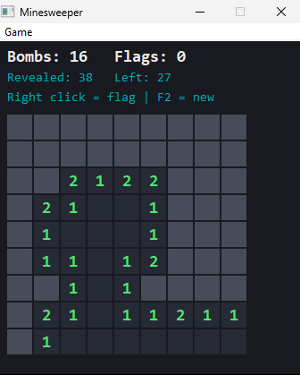
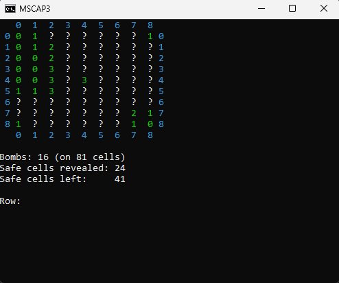

# Minesweeper (C++)

A Minesweeper game written in C++ with my own bomb-placement algorithm.
It started as a console game and now also has a clickable Windows version.

## Idea

I was interested in the map-generating rules of the game. The original version is played with keyboard
input. The goal was to generate a map that follows these rules:

- A bomb can never have only bomb neighbours (implemented: such a bomb is moved)
- The number of bombs depends on the difficulty level: 20 / 30 / 40 % of the cells (implemented)

Further development:

- The first click is always safe, with no bomb


## Demo

Window version:



Console version:



## Versions

| File | What it is |
|------|------------|
| `Minesweeper.cpp` | Original console version |
| `Minesweeper_new.cpp` | Cleaned-up console version (same logic, better names, input checks) |
| `MinesweeperGUI.cpp` | Clickable window version (same logic, Win32 GUI) |

## Controls (window version)

- **Left click**: reveal a cell
- **Right click**: place or remove a flag
- **F2**: new game
- **Game menu**: difficulty (20 / 30 / 40 % bombs) and map size (9, 12, 16, 20)

## Build

Needs a Windows C++ compiler such as MinGW (MSYS2 UCRT64).

```bash
g++ MinesweeperGUI.cpp -o MinesweeperGUI.exe -mwindows -static
```

## How the algorithm works

1. Bombs are placed at random cells.
2. A bomb with too many bombs around it is moved to a new random cell and checked again.
3. Every cell next to a bomb gets its bomb count.
4. Opening an empty cell reveals its neighbours recursively.
