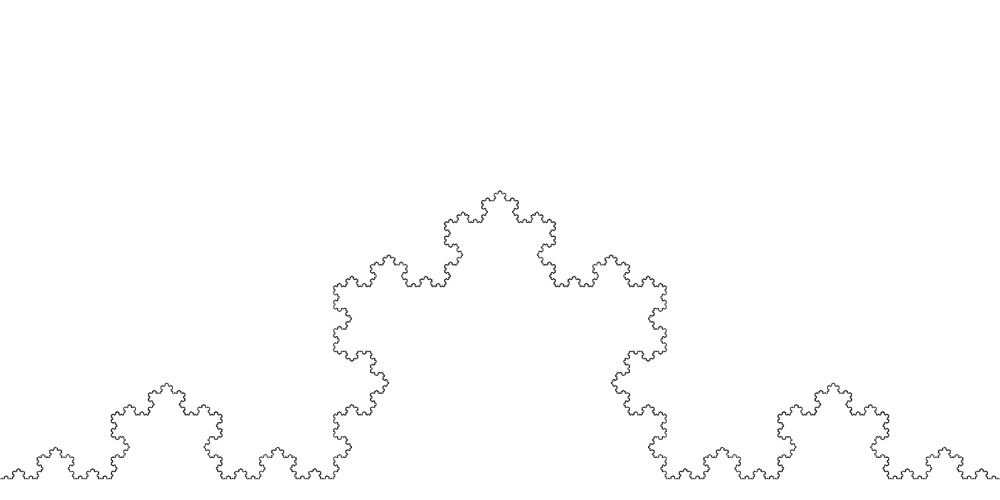
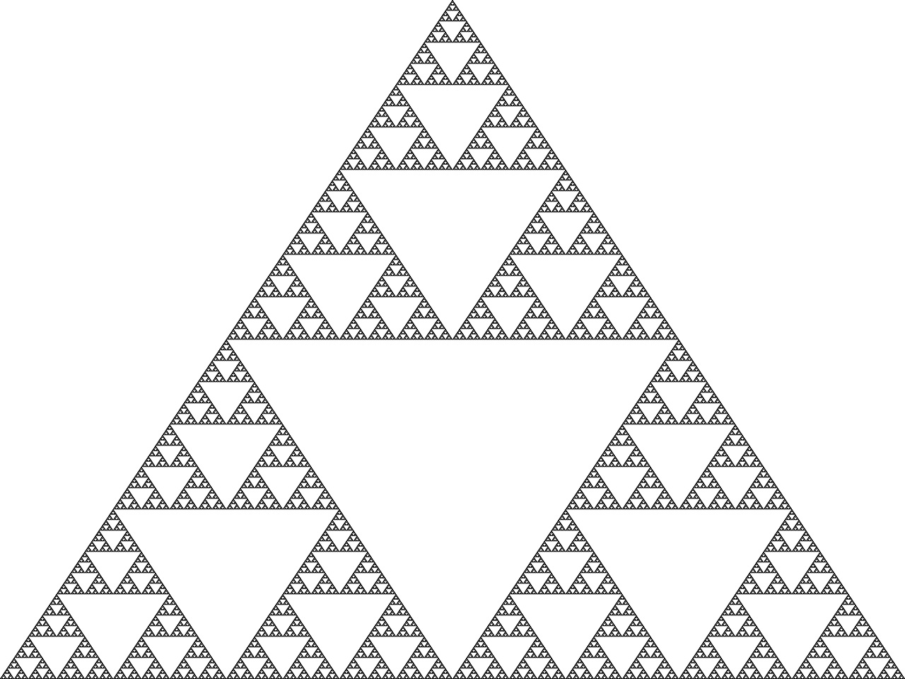
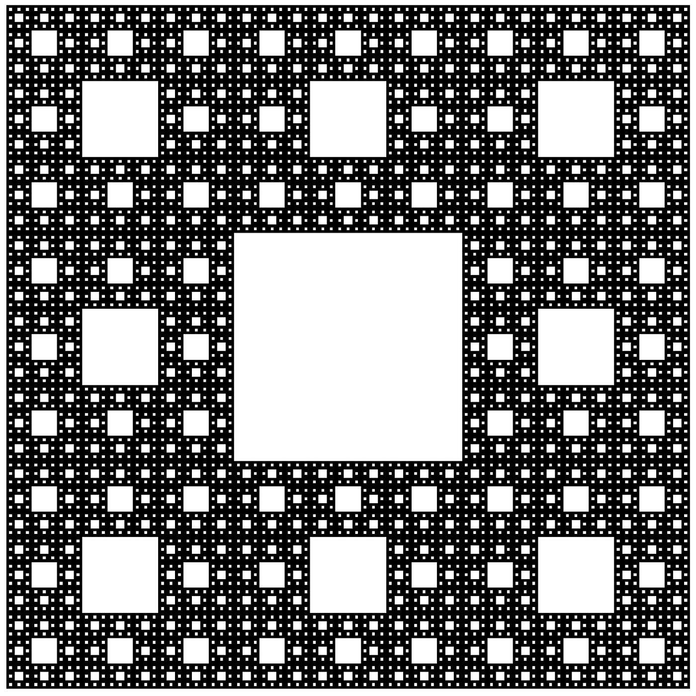
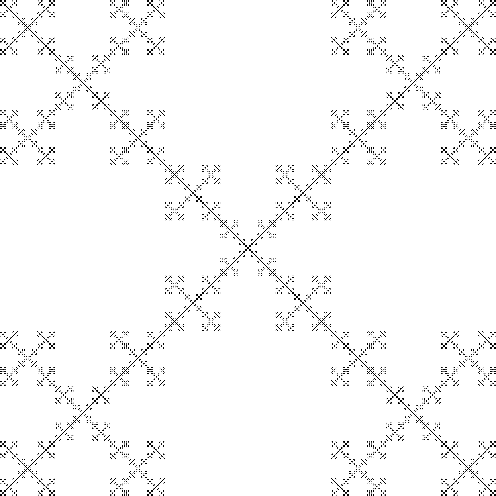
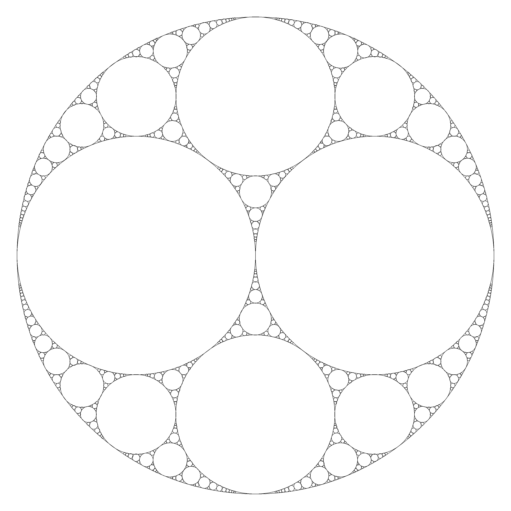
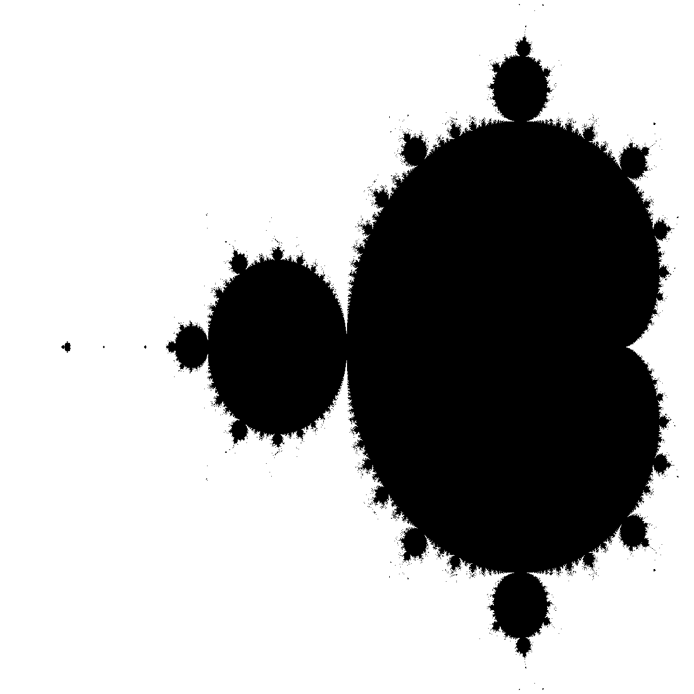
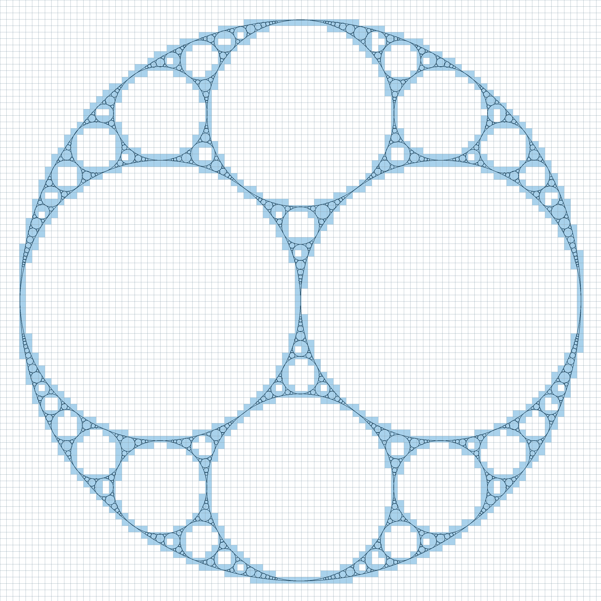
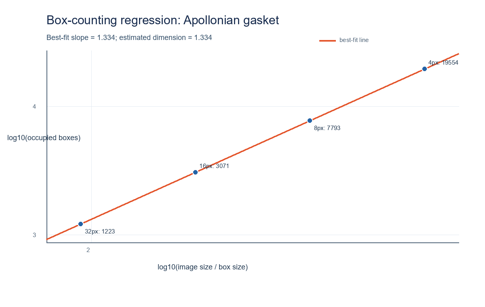

# Fractals and Box-Counting Dimension

**Code written by Abel Domokos**

This project uses the box-counting method to estimate the Minkowski (box-counting) dimension of geometric shapes and fractals. I tested the method on regular shapes such as circles and on fractals including the Koch curve, Sierpinski triangle, Apollonian gasket, and Mandelbrot set.

I also wrote Python programs to generate fractal images at resolutions suited to the measurements. The [`results/results.txt`](results/results.txt) file contains the original estimates and reference dimensions, together with the newer Apollonian-gasket and Mandelbrot measurements. The results can be compared with the reference values to assess how well the method works; they are estimates affected by image resolution and box size, rather than proofs of exact dimensions.

## Project layout

```text
final_project/
├── images/     Generated images, examples, and plots
├── results/    Measurements and other result data
├── scripts/    Python source files
└── README.md
```

## Image gallery

### Fractals and patterns

**Koch curve**



**Sierpinski triangle**



**Sierpinski carpet**



**Vicsek fractal**



**Apollonian gasket**



**Filled Mandelbrot set**



## Box-counting example

Box counting covers a shape with a grid of same-sized squares and counts the squares that touch the shape. Repeating this with smaller squares gives the measurements used for the regression.

The image below shows the Apollonian gasket covered with a 32-pixel grid. Blue boxes intersect the dark lines and are counted.



The regression plot below uses measurements produced by `scripts/boxcount.py`. Blue dots show the counts for each box size, and the red line is the best-fitting line. Its slope estimates the dimension.



The script also generates matching coverage and regression images for the filled Mandelbrot set. They are saved in `images/` but omitted here to keep the README concise.

## Results: my estimates and theoretical values

| Shape | My estimated dimension | Theoretical/reference dimension |
|---|---:|---:|
| Koch curve | 1.2468 | 1.262 |
| Sierpinski triangle | 1.5855 | 1.585 |
| Circle outline | 0.9799 | 1 |
| Filled circle | 1.9759 | 2 |
| Carpet | 1.8706 | 1.893 |
| Second carpet result | 1.8680 | Not recorded |
| Vicsek fractal | 1.4852 | 1.465 |
| Apollonian gasket | 1.3340 | About 1.306 |
| Filled Mandelbrot set | 1.8977 | 2 |

The original estimates and references are from [`results/results.txt`](results/results.txt). The Apollonian value is an approximate reference for the classic Apollonian gasket. The Mandelbrot value refers to the dimension of the filled set; this analysis estimates it from a finite-resolution image. The detailed box counts for the Apollonian and Mandelbrot images are in [`results/box_counting_results.csv`](results/box_counting_results.csv).

## Run the box-counting analysis

Use Python 3 with Pillow installed. Generate the Mandelbrot input image, then measure both shapes:

```bash
python -m pip install Pillow
python scripts/mandelbrot.py
python scripts/boxcount.py
```

`boxcount.py` uses `images/apollonian_gasket_reference.png` and `images/mandelbrot.png`. It creates a coverage image and regression plot for each shape, updates the CSV and the box-counting section of `results/results.txt` while preserving the earlier measurements, and prints the estimated dimensions. It can be run from the project directory or another working directory.

## Other scripts

| Script | Purpose |
|---|---|
| `scripts/boxcount.py` | Counts boxes on the Apollonian gasket and filled Mandelbrot set; saves coverage images, regression plots, and measurements. |
| `scripts/box.py` | Earlier box-counting experiment using the Koch curve; requires NumPy and Matplotlib. |
| `scripts/apollonian.py` | Generates an Apollonian gasket; requires Pygame. |
| `scripts/carpet.py` | Generates a carpet-style fractal. |
| `scripts/circle.py` | Generates a circle outline. |
| `scripts/koch.py` | Generates a Koch curve. |
| `scripts/mandelbrot.py` | Generates a filled Mandelbrot set image. |
| `scripts/vicsek.py` | Generates a Vicsek-style fractal. |

Image files are kept in `images/`, and scripts save generated images there.
